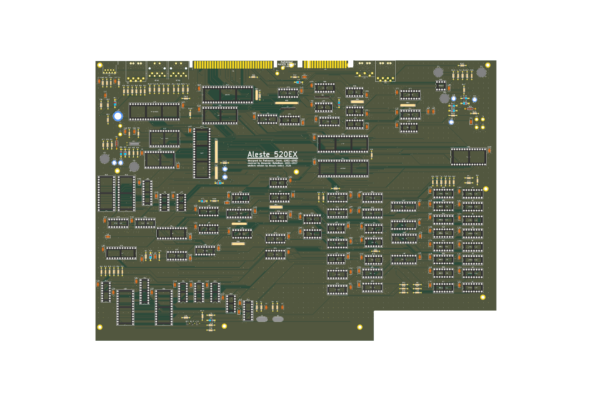
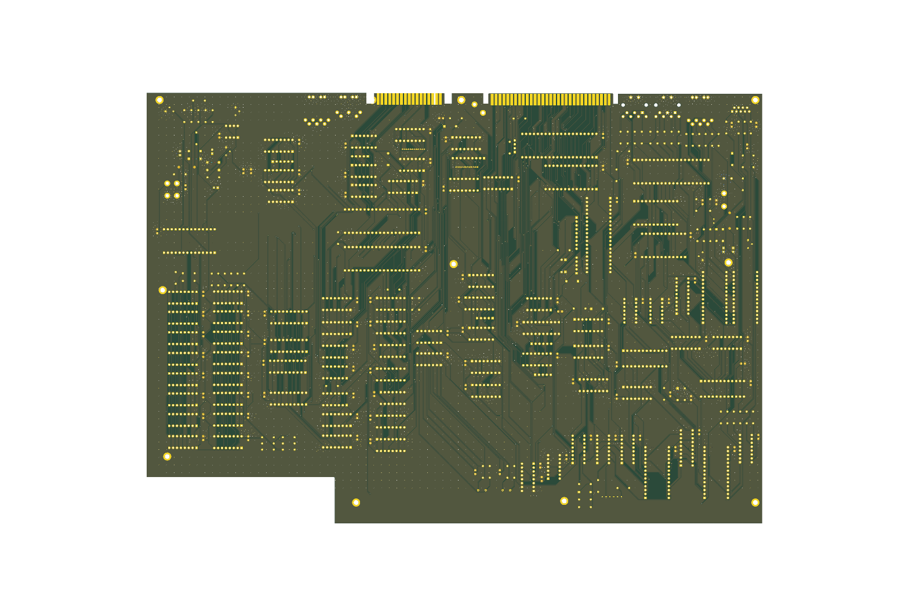
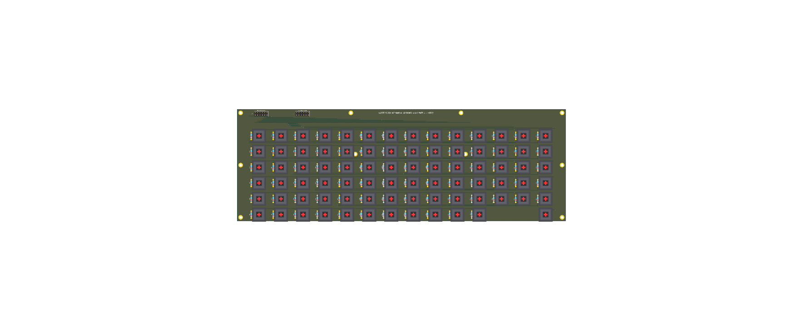

# Aleste 520EX — Edizione Completa Western Through-Hole (THT) (KiCad 9.0)

🌐 **Lingua / Language**: [**🇬🇧 Read in English (`README.md`)**](README.md) | **🇮🇹 Italiano**

---

Riproduzione hardware completa del personal computer sovietico **Aleste 520EX del 1993** basato su CPU Z80 (architettura ibrida compatibile Amstrad CPC 6128 e MSX2 progettata da Patisonic a Omsk, Russia), interamente riprogettata in **KiCad 9.0** utilizzando **al 100% componenti occidentali Through-Hole (THT)**, corredata della sua **Tastiera Meccanica Cherry MX dedicata (`keyboard/`)** e del **Case Parametrico Anti-Flessione (`case/`)**.

---

## 1. Struttura del Repository

Il progetto è suddiviso in quattro directory modulari:

| Directory | Contenuto Principale | Descrizione |
| :--- | :--- | :--- |
| **[`board/`](board/)** | `Aleste520v4.kicad_pro`, `.kicad_sch`, `.kicad_pcb`, `Componenti_Aleste520v4.csv` | **Scheda Madre (`400.9 × 280.5 mm`)**: 100% IC occidentali THT (`U1..U89`), connettori tastiera standard `2x06` passo `2.54 mm` (`X8`, `X9`), 11 fori di fissaggio `M3` (`MH1..MH11`), piazzole alimentazione/batteria RTC etichettate (`P1..P8`), **0 errori ERC / 0 violazioni DRC**. |
| **[`keyboard/`](keyboard/)** | `Aleste520_Keyboard.kicad_pro`, `.kicad_sch`, `.kicad_pcb`, `Componenti_Tastiera_Aleste520.csv`, [`README.md`](keyboard/README.md) | **Tastiera Meccanica (`358.0 × 122.0 mm`)**: 82 switch Cherry MX (`SW1..SW81` matrice + `SW82` Reset Hardware), 81 diodi `1N4148` anti-ghosting (Full NKRO), connettori IDC `2x06` passo `2.54 mm` (`J1`, `J2`), 10 fori `M3` anti-flessione (`MH1..MH10`), **0 errori ERC / 0 violazioni DRC**. |
| **[`case/`](case/)** | `Aleste520_Case.FCStd`, `Aleste520_Case.step`, `keyboard_plate.dxf`, [`README.md`](case/README.md) | **Case Desktop Custom (`416.0 × 296.0 × 62.0 mm`)**: Progetto 3D nativo FreeCAD 1.1 (`Aleste520_Case.FCStd`, `Aleste520_Bottom_Case.FCStd`, `Aleste520_Top_Cover.FCStd`, `Aleste520_Switch_Plate.FCStd`, `Aleste520_Case.step`) (Base Inferiore, Scocca Superiore inclinata, Piastra Switch `1.5 mm` e modalità suddivisa in 4 quadranti per stampanti 3D $256\times 256\text{ mm}$) + file `keyboard_plate.dxf` pronto per taglio laser con **Sistema di Supporto Tastiera Anti-Flessione a 3 Stadi**. |
| **[`rom/`](rom/)** | `AL512.BIN`, `RFCOLDAT.BIN`, `RFVDKEY.BIN`, `MAPPER.BIN`, `ROMRAM.BIN`, `AF.BIN` | **Immagini Firmware Originali**: 100% compatibili bit-per-bit con questa scheda occidentale (interfaccia di boot/setup nativa in inglese, supporto set caratteri Latino/ASCII e Cirillico). |

---

## 2. Caratteristiche della Scheda Madre (`board/`)

* **Conversione al 100% a Integrati Occidentali (`U1..U89`)**:
  * Tutti i circuiti integrati logici, di memoria e le periferiche sovietiche sono stati convertiti nei rispettivi equivalenti occidentali standard (`74LSxx`, `74HCxx`, `Z80CPU`, `8255`, `8253`, `8251A`, `8272`, `MC6845`, `AY-3-8910`, `MC146818P`, `HM50256P-20` / `41256`).
  * **Soluzione definitiva per `KR1802IR1` (`КР1802ИР1`)**: I rari register file sovietici dual-port 16×4 a 24 pin in `U60`, `U61`, `U82` e `U83` sono stati sostituiti con il componente occidentale **AMD `AM29705` (DIP-28)**, cablando correttamente i doppi bus indirizzi (`A0..A3`, `B0..B3`), gli strobe di scrittura (`~WE1`, `~WE2`), i latch di uscita trasparenti (`~A-LO = GND`, `LE = VCC`) e le uscite open-collector (`~OE-A`) sia per la palette colori (`U60`+`U61`) sia per il sottosistema tastiera/mapper (`U82`+`U83`).
  * Tutti i designatori degli integrati sono stati standardizzati da `D1..D89` a `U1..U89`.
* **Connettori Tastiera Aggiornati a Passo Standard $2.54\text{ mm}$ (`X8` e `X9`)**:
  * Sostituiti i vecchi connettori fuori standard a passo $1.27\text{ mm}$ su `X8` e `X9` con **Header/IDC Box Header standard a doppia fila `2x06` passo $2.54\text{ mm}$ ($0.1''$)** (`Connector_PinHeader_2.54mm:PinHeader_2x06_P2.54mm_Vertical`), compatibili con comuni cavi piatti IDC a 12 poli o cablaggi DuPont.
* **11 Fori di Fissaggio Meccanico `M3` (`MH1..MH11`)**:
  * Aggiunti 11 fori `M3` metallizzati ($\varnothing\ 3.2\text{ mm}$ foro, $\varnothing\ 6.0\text{ mm}$ piazzola connessa al piano `GND`) lungo il perimetro, al centro e nella zona anteriore sotto la tastiera per il fissaggio alle colonnine del case e ai pilastri coassiali anti-flessione della tastiera.
* **PCB a 2 Layer Completamente Sbrogliato (`400.9 × 280.5 mm`)**:
  * **0 Errori ERC** sullo schema elettrico gerarchico (`board/Aleste520v4.kicad_sch` + 6 sottoschemi).
  * **0 Violazioni DRC e 0 Connessioni Mancanti** sul PCB (`board/Aleste520v4.kicad_pcb`).
  * Piani di massa `GND` completi su `F.Cu` e `B.Cu` con **Thermal Relief** (`0.35 mm` razze, `0.25 mm` isolamento) per agevolare la saldatura manuale, oltre **3.670 via di cucitura (`stitching vias`)** e 95 condensatori di disaccoppiamento locali da `100 nF` (`C32..C128`).

---

## 3. Guida all'Alimentazione: PicoPSU + Collegamento alla Rete $220\text{ V AC}$

La scheda madre dell'Aleste 520EX richiede principalmente **`+5V DC`** (piano `VCC`, con un assorbimento di $\approx 2.2\text{ A} \dots 2.8\text{ A}$ per gli 89 IC TTL/CMOS/NMOS) più **`+12V DC`** (utilizzati dallo slot di espansione `X1` e dal connettore video `X5.B1`), oltre a una **batteria tampone a bottone da `3V` (`CR2032`)** per il Real-Time Clock `MC146818P` (`U19`).

### 3.1 Collegamento Sicuro alla Rete $220\text{ V AC}$
Per garantire la massima sicurezza elettrica ed evitare di portare la tensione di rete a $220\text{ V AC}$ all'interno del case stampato in 3D:
1. **Alimentatore Esterno AC/DC ($220\text{ V AC} \rightarrow 12\text{ V DC}$)**: Utilizzare un alimentatore switching esterno certificato (tipo "brick" da notebook/monitor) da **`12V DC / 5A (60W)`** con spinotto cilindrico standard `5.5 × 2.5 mm`.
2. **PicoPSU DC-DC Interno (`PicoPSU-80` / `PicoPSU-120` o convertitore Buck `12V->5V 5A`)**:
   * Installare la presa DC da pannello `5.5 × 2.5 mm` e l'interruttore a bilanciere posteriore negli appositi scassi predisposti sul pannello posteriore del case ([`case/Aleste520_Case.FCStd`](case/Aleste520_Case.FCStd)).
   * Collegare il filo **Verde (`PS_ON#`, Pin 16 del connettore ATX 24-pin)** della PicoPSU a **Massa (`GND`, filo Nero, Pin 15/17)** tramite l'interruttore posteriore per comandare l'accensione della PicoPSU.
   * Portare i `+5V` (filo Rosso) e i `+12V` (filo Giallo) della PicoPSU alle piazzole `P1..P6` della scheda madre secondo la tabella seguente.

### 3.2 Mappa delle Piazzole Alimentazione e Batteria RTC (`P1..P8`)

| Piazzola | Etichetta Serigrafica | Net | Coordinate PCB `(X, Y)` | Collegamento |
| :--- | :--- | :--- | :--- | :--- |
| **`P1`** | `+5V_VCC` | `VCC` (`+5V`) | `(321.31, 240.03)` | **PicoPSU `+5V` (Filo Rosso, sez. $\ge 0.75\text{ mm}^2$)** — Alimentazione logica principale |
| **`P2`** | `GND_PWR` | `GND` | `(311.15, 250.19)` | **PicoPSU `GND` (Filo Nero, sez. $\ge 0.75\text{ mm}^2$)** — Ritorno di massa principale |
| **`P3`** | `+12V_EXP` | `+12V` | `(303.53, 250.19)` | **PicoPSU `+12V` (Filo Giallo)** — Slot di espansione `X1` e connettore `X5.B1` |
| **`P4`** | `GND_EXP` | `GND` | `(295.91, 250.19)` | **PicoPSU `GND` (Filo Nero)** — Ritorno di massa ausiliario |
| **`P5`** | `+5V_AUX` | `VCC` (`+5V`) | `(292.10, 260.35)` | **PicoPSU `+5V` (Filo Rosso)** — Ramo `+5V` in parallelo a `P1` (riduce la caduta di tensione) |
| **`P6`** | `GND_AUX` | `GND` | `(306.07, 265.43)` | **PicoPSU `GND` (Filo Nero)** — Ramo `GND` in parallelo a `P2` |
| **`P7`** | `BAT+_3V` | `3V` (RTC `MC146818`) | `(330.20, 232.41)` | **Portabatteria `CR2032` Polo `+` (Positivo)** — Backup RTC CMOS **(SOLO `3V`!)** |
| **`P8`** | `BAT-_GND` | `GND` | `(330.20, 226.06)` | **Portabatteria `CR2032` Polo `-` (Negativo)** — Massa batteria RTC |

---

## 4. Tastiera Meccanica Dedicata (`keyboard/`)

Consulta [**`keyboard/README.md`**](keyboard/README.md) per la documentazione completa della tastiera, la tabella della matrice $11\times 8$ e il pinout dei connettori.

* **Dimensioni PCB**: `358.0 × 122.0 mm` (FR4 a 2 layer, spessore `1.6 mm`, **0 errori ERC / 0 violazioni DRC**).
* **Switch Meccanici**: 81 tasti Cherry MX (`SW1..SW81`) disposti nella matrice nativa $11 \times 8$ dell'Aleste 520EX (`KM0..KM10` $\times$ `KM11..KM18`) + 1 tasto Cherry MX dedicato al **Reset Hardware (`SW82`, `SBRES` $\rightarrow$ `GND`)**.
* **Anti-Ghosting Totale (Full NKRO)**: 81 diodi through-hole `1N4148` (`D1..D81`, package `DO-35`) con catodo (`Pin 1`) sulla colonna `KM0..KM10` e anodo (`Pin 2`) sul `Pin 1` dello switch (orientati per lo strobe attivo-basso generato dal decoder `74LS145` `U80`).
* **Connessione Flat 1:1**: Due connettori `2x06` passo $2.54\text{ mm}$ (`J1` e `J2`) si collegano direttamente 1:1 ai connettori `X8` e `X9` della scheda madre.

---

## 5. Case Desktop Custom con Supporti Anti-Flessione (`case/`)

Consulta [**`case/README.md`**](case/README.md) per le istruzioni di stampa 3D, taglio laser della piastra e assemblaggio meccanico.

* **Dimensioni Esterne**: `416.0 × 296.0 × 62.0 mm` (profilo inclinato ergonomico: `32 mm` sul fronte, `62 mm` sul pannello I/O posteriore).
* **Sistema Strutturale Anti-Flessione a 3 Stadi** (progettato per azzerare qualsiasi flessione della tastiera durante la digitazione lungo i $358\text{ mm}$ di larghezza):
  1. **Piastra di Montaggio Switch da `1.5 mm`** (`case/keyboard_plate.dxf` pronta per taglio laser in alluminio/acciaio/FR4, oppure stampabile in 3D da `case/Aleste520_Switch_Plate.FCStd`).
  2. **Reticolo Ortogonale di Nervature di Rinforzo** integrato sotto la scocca superiore (`4.0 × 8.0 mm` di battuta perimetrale + 2 costole trasversali + 2 costole longitudinali).
  3. **7 Colonne Coassiali di Scarico a Compressione (`MH5..MH11`)** che scaricano la forza verticale di digitazione dalla tastiera (`MH1..MH10`) attraverso la scheda madre (`MH5..MH11`) direttamente sul fondo del case.

---

## 6. Guida alla Programmazione di EPROM e PROM Bipolari (`rom/`)

Tutti e 6 i file binari originali presenti nella cartella [`rom/`](rom/) sono **compatibili al 100% bit-per-bit** con questa scheda occidentale: nessuna linea di indirizzo (`A0..A15`) o di dato (`D0..D7`) è stata permutata durante lo sbroglio, e i sostituti occidentali `AM29705` (`U60`, `U61`, `U82`, `U83`) lavorano in modalità trasparente non invertente identica ai `KR1802IR1` originali.

> **🇬🇧 Nota sulla Lingua delle ROM**: Il firmware `rom/AL512.BIN` integra già nativamente **l'interfaccia di boot e setup in lingua inglese** (`ALESTE 520EX`, `PATISONIC 1993`, `SETUP`) e contiene la doppia tabella caratteri **Latino/ASCII occidentale** + Cirillico (commutabile con il tasto `RUS/LAT`).

### 6.1 Tabella di Mappatura Firmware

| File Binario | Dimensione | Zoccolo PCB | Integrato Occidentale (Target) | Equivalenti Compatibili | Integrato Sovietico Originale | Funzione |
| :--- | :--- | :--- | :--- | :--- | :--- | :--- |
| [`rom/AL512.BIN`](rom/AL512.BIN) | `65.536 B` (64 KB) | **`U31`** | **`27C512`** (DIP-28) | `M27C512`, `AM27C512`, `W27C512` (EEPROM) | `К573РФ4` (`K573RF4`) | System BIOS, BASIC, Boot & AMSDOS |
| [`rom/RFCOLDAT.BIN`](rom/RFCOLDAT.BIN) | `2.048 B` (2 KB) | **`U62`** | **`2716` / `27C16`** (DIP-24) | `TMS27C16`, `M2716`, **`AT28C16`** (EEPROM) | `К573РФ2` (`K573RF2`) | Lookup Palette Colori (`XD0..XD5`, `VRAMACC`) |
| [`rom/RFVDKEY.BIN`](rom/RFVDKEY.BIN) | `2.048 B` (2 KB) | **`U65`** | **`2716` / `27C16`** (DIP-24) | `TMS27C16`, `M2716`, **`AT28C16`** (EEPROM) | `К573РФ2` (`K573RF2`) | Sincronismi Video (`SYNC*`, `HY*`, `SINT*`) e Scan Tastiera (`KK0..KK3`) |
| [`rom/MAPPER.BIN`](rom/MAPPER.BIN) | `256 B` (`256×4` bit) | **`U28`** | **`AM27S20`** (DIP-16 OC) | `N82S129`, `SN74S287`, `MMI6301`, `MB7052` | `КР556РТ4` (`KR556RT4`) | Memory Bank Address Mapper (`MAP14..MAP17`) |
| [`rom/ROMRAM.BIN`](rom/ROMRAM.BIN) | `256 B` (`256×4` bit) | **`U67`** | **`AM27S20`** (DIP-16 OC) | `N82S129`, `SN74S287`, `MMI6301`, `MB7052` | `КР556РТ4` (`KR556RT4`) | Decoder Abilitazione Bus e Banchi (`/ROMEN`, `/RAMEN`, `BUFFER0..1`) |
| [`rom/AF.BIN`](rom/AF.BIN) | `32 B` (`32×8` bit) | **`U69`** | **`SN74188`** (DIP-16 OC) | `N82S23`, `AM27S18`, `MMI6330`, `TBP18SA030` | `К155РЕ3` (`K155RE3`) | PROM Macchina a Stati / Precompensazione Floppy Disk Controller |

> **⚠️ Nota Critica sul Tipo di Uscita (`U28`, `U67`, `U69`)**: Lo schema originale utilizza PROM bipolari con uscite **Open-Collector (OC)** (`82S129` / `AM27S20` per `U28`, `U67` e `82S23` / `SN74188` per `U69`). In particolare, su `U28` (`MAPPER.BIN`) il pin 13 (`CS1`) è pilotato da `/MAPBLK` e le uscite `MAP14..MAP17` sono collegate in **wired-OR** diretto con i register file open-collector `U87`/`U88` (`74LS170`): pertanto **`U28` DEVE obbligatoriamente essere un modello Open-Collector** (`AM27S20` / `82S129` / `74S287`, e **non** la versione totem-pole/tri-state `82S126` / `74S387` / `AM27S21`).

