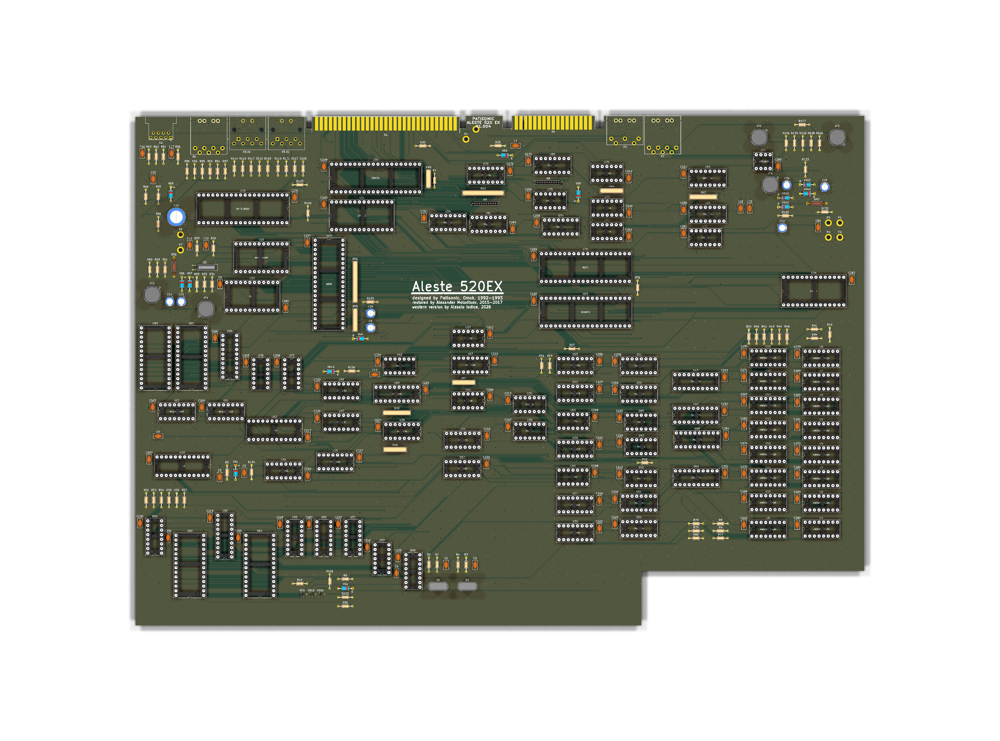
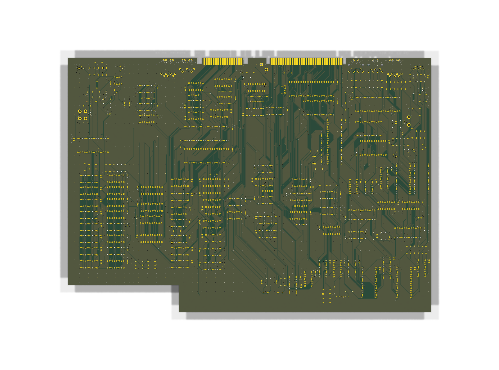

# Aleste 520EX — Edizione Occidentale Through-Hole (THT) (KiCad 9.0)

🌐 **Lingua / Language**: [**🇬🇧 Read in English (`README.md`)**](README.md) | **🇮🇹 Italiano**

---

Riproduzione occidentale completa del personal computer sovietico **Aleste 520EX (1993)** basato su Z80 (architettura ibrida compatibile Amstrad CPC 6128 e MSX2 progettata da Patisonic a Omsk, Russia), interamente riprogettata in **KiCad 9.0** utilizzando **componenti 100% occidentali Through-Hole (THT)** e un PCB a 2 layer completamente sbrogliato.

---

## 1. Caratteristiche Principali di Questa Release

* **Conversione 100% Integrati Occidentali (`U1..U89`)**:
  * Tutti gli integrati logici, di memoria e periferiche sovietici sono stati convertiti nei corrispondenti standard occidentali (`74LSxx`, `74HCxx`, `Z80CPU`, `8255`, `8253`, `8251A`, `8272`, `MC6845`, `AY-3-8910`, `MC146818P`, `HM50256P-20` / `41256`).
  * **Risoluzione definitiva `KR1802IR1` (`КР1802ИР1`)**: Sostituiti i rari register file sovietici dual-port 16×4 a 24 pin (`U60`, `U61`, `U82`, `U83`) con gli equivalenti occidentali **AMD `AM29705` (DIP-28)**, cablando correttamente il doppio bus indirizzi (`A0..A3`, `B0..B3`), gli strobe di scrittura (`~WE1`, `~WE2`), i latch d'uscita in modalità trasparente non invertente (`~A-LO = GND`, `LE = VCC`) e le uscite open-collector (`~OE-A`) sia per la palette colori (`U60`+`U61`) sia per la scansione tastiera/mapper (`U82`+`U83`).
  * Uniformati tutti i designatori degli integrati dalla nomenclatura russa `D1..D89` allo standard occidentale `U1..U89`.
* **Montaggio 100% Through-Hole (THT)**:
  * Tutti i componenti (zocoli DIP `U1..U89`, resistenze, condensatori ceramici/elettrolitici, diodi, transistor, quarzi, trimmer, connettori) adottano footprint THT standard per una saldatura manuale agevole e una manutenzione immediata.
  * Sulla serigrafia superiore (`F.Silkscreen`) sono stampati sia i designatori (`U1..U89`) sia il codice integrato (`Value`, es. `74LS174`, `AM29705`, `Z80CPU`) centrati all'interno di ogni zoccolo DIP.
* **PCB 2-Layer Completamente Sbrogliato (`400,9 × 280,5 mm`)**:
  * **0 Errori ERC** sullo schema elettrico gerarchico (`Aleste520v4.kicad_sch` + 6 sottoschemi).
  * **0 Violazioni DRC e 0 Pin Non Connessi** sul PCB (`Aleste520v4.kicad_pcb`).
  * **Integrità del Segnale e Distribuzione Alimentazione**:
    * Netclass dedicate per `Power` (`0.40 mm`), segnali `Critical` ad alta frequenza / clock / strobe / video RGB e audio analogico (`0.25 mm` con isolamento anti-crosstalk maggiorato a `0.28 mm`) e `Default` (`0.25 mm`, clearance `0.20 mm`).
    * Piani di massa `GND` su `F.Cu` e `B.Cu` dotati di **Thermal Relief** (raggi da `0.35 mm`, gap `0.25 mm`) per facilitare la saldatura a mano, cuciti tra loro con oltre **3.670 via di stitching GND** (`0.6 mm / 0.3 mm`).
    * 95 condensatori di disaccoppiamento locali da `100 nF` (`C32..C128`) posizionati a ridosso del pin `VCC` di ciascun integrato.

---

## 2. Struttura del Progetto

* `Aleste520v4.kicad_pro` — File di progetto KiCad 9.0
* `Aleste520v4.kicad_sch` — Schema principale + fogli gerarchici:
  * `cpu.kicad_sch` — CPU Z80, ROM di sistema (`U31`), PROM Mapper (`U28`), RAM tastiera/mapper (`U82`, `U83` `AM29705`), logica di wait/reset
  * `ram.kicad_sch` — 512 KB DRAM (`U1..U16`, `HM50256P-20` / `41256`), multiplexer indirizzi e 95 condensatori di decoupling (`C32..C128`)
  * `clkcrtc.kicad_sch` — Generatore di clock principale, CRTC (`MC6845`), EPROM sincronismi video/tastiera (`U65`), PROM decodifica bus (`U67`)
  * `gatearray.kicad_sch` — Shift register video, EPROM lookup colori (`U62`) e RAM Palette Colori (`U60`, `U61` `AM29705`)
  * `periph.kicad_sch` — PPI (`8255`), PIT (`8253`), USART (`8251A`), PSG (`AY-3-8910`), RTC (`MC146818P`), audio e porte I/O
  * `fdc.kicad_sch` — Floppy Disk Controller (`8272` / `uPD765`), separatore dati e PROM macchina a stati (`U69`)
* `Aleste520v4.kicad_pcb` — PCB a 2 layer completamente sbrogliato (`400,9 × 280,5 mm`)
* `Aleste520v2.kicad_sym` / `Aleste520v3-rescue.kicad_sym` / `Aleste520v4.pretty/` — Librerie simboli e footprint del progetto
* `Componenti_Aleste520v4.csv` (separatore `;` per Excel IT) / `Componenti_Aleste520v4_comma.csv` (separatore `,`) — Distinta componenti completa (BOM) con tipo componente, designatore (`U1..U89`, `C1..C128`, `R1..R109`, ecc.), codice componente e footprint THT.
* `rom/` — Immagini binarie originali delle ROM/PROM (compatibili al 100% bit-per-bit con questa scheda).

---

## 3. Guida alla Programmazione delle EPROM e PROM Bipolari

Tutti i 6 file binari originali presenti nella cartella `rom/` sono **compatibili al 100% così come sono**: non è stato effettuato alcuno scambio di pin indirizzo/dati durante lo sbroglio e gli `AM29705` (`U60`, `U61`, `U82`, `U83`) lavorano in modalità trasparente non invertente esattamente come i `KR1802IR1` originali.

### 3.1 Tabella di Corrispondenza Firmware

| File Binario | Dimensione | Zocolo PCB | Integrato Occidentale | Equivalenti Compatibili | Originale Sovietico | Funzione |
| :--- | :--- | :--- | :--- | :--- | :--- | :--- |
| `rom/AL512.BIN` | `65.536 B` (64 KB) | **`U31`** | **`27C512`** (DIP-28) | `M27C512`, `AM27C512`, `W27C512` (EEPROM) | `К573РФ4` (`K573RF4`) | BIOS di sistema, BASIC, Boot e AMSDOS |
| `rom/RFCOLDAT.BIN` | `2.048 B` (2 KB) | **`U62`** | **`2716` / `27C16`** (DIP-24) | `TMS27C16`, `M2716`, **`AT28C16`** (EEPROM) | `К573РФ2` (`K573RF2`) | Lookup Table Palette Colori (`XD0..XD5`, `VRAMACC`) |
| `rom/RFVDKEY.BIN` | `2.048 B` (2 KB) | **`U65`** | **`2716` / `27C16`** (DIP-24) | `TMS27C16`, `M2716`, **`AT28C16`** (EEPROM) | `К573РФ2` (`K573RF2`) | Sincronismi Video (`SYNC*`, `HY*`, `SINT*`) e Scansione Tastiera (`KK0..KK3`) |
| `rom/MAPPER.BIN` | `256 B` (`256×4` bit) | **`U28`** | **`AM27S20`** (DIP-16 OC) | `N82S129`, `SN74S287`, `MMI6301`, `MB7052` | `КР556РТ4` (`KR556RT4`) | Mapper Indirizzi Banchi RAM (`MAP14..MAP17`) |
| `rom/ROMRAM.BIN` | `256 B` (`256×4` bit) | **`U67`** | **`AM27S20`** (DIP-16 OC) | `N82S129`, `SN74S287`, `MMI6301`, `MB7052` | `КР556РТ4` (`KR556RT4`) | Decodifica abilitazione bus (`/ROMEN`, `/RAMEN`, `BUFFER0..1`) |
| `rom/AF.BIN` | `32 B` (`32×8` bit) | **`U69`** | **`SN74188`** (DIP-16 OC) | `N82S23`, `AM27S18`, `MMI6330`, `TBP18SA030` | `К155РЕ3` (`K155RE3`) | Macchina a stati / precompensazione Floppy Disk Controller |

> **⚠️ Nota Critica sulle Uscite Open-Collector (`U28`, `U67`, `U69`)**: Lo schema utilizza PROM bipolari **Open-Collector (OC)** (`82S129` / `AM27S20` per `U28`, `U67` e `82S23` / `SN74188` per `U69`). In particolare, per `U28` (`MAPPER.BIN`) il pin 13 (`CS1`) è pilotato da `/MAPBLK` e le uscite `MAP14..MAP17` sono collegate in wired-OR con i register file open-collector `U87`/`U88` (`74LS170`): **`U28` DEVE quindi essere necessariamente un modello Open-Collector** (`AM27S20` / `82S129` / `74S287`, **non** la versione totem-pole `82S126` / `74S387` / `AM27S21`).

---

### 3.2 Materiale e Strumenti Necessari

#### A. Per le 3 EPROM / EEPROM MOS (`U31`, `U62`, `U65`)
1. **Integrati richiesti**:
   * **1× `27C512` (DIP-28, 64K×8, tempo di accesso $\le 150\text{ ns}$)** per **`U31`**.
     * *Consigliati*: Winbond **`W27C512-45Z`** (EEPROM cancellabile elettricamente, drop-in diretto) oppure ST **`M27C512-10F1`**.
   * **2× `27C16` / `2716` (DIP-24, 2K×8, tempo di accesso $\le 150\text{ ns}$)** per **`U62`** e **`U65`**.
     * *Requisito di velocità*: `U62` e `U65` lavorano su reti combinatorie video/I/O (`RFCOLDAT` e `RFVDKEY`). Usare versioni CMOS veloci ($\le 150\text{ ns}$) oppure **Atmel `AT28C16-15PC` (EEPROM parallela DIP-24 da 150 ns)**.
     * **Perché la `AT28C16` è fortemente consigliata per `U62` e `U65`**: Su questo PCB il Pin 21 (`VPP` sulla `2716`, `~WE` sulla `AT28C16`) è collegato direttamente a `VCC (+5V)`. Ciò significa che una **`AT28C16` è 100% plug-and-play negli zocoli `U62` e `U65` senza alcun adattatore**, si programma a 5V con qualsiasi programmatore USB economico ed evita la tensione di programmazione $V_{PP} = 25\text{ V}$ richiesta dalle vecchie `2716` NMOS!
2. **Strumenti necessari**:
   * **Programmatore Universale USB**: **XGecu TL866II Plus**, **T48 (TL866-3G)**, **T56** oppure **GQ-4X4**.
   * *(Se si usano `27C512` / `2716` con finestra UV)*: **Cancellatore UV per EPROM** (lampada UV-C a 253,7 nm, ~15–20 minuti di esposizione) ed etichette opache per coprire la finestra al quarzo dopo la scrittura.
   * *(Se si usano `2716` NMOS d'epoca a $25\text{ V}$)*: Assicurarsi che il programmatore supporti $V_{PP} = 25\text{ V}$ (es. XGecu **T48**/**T56** o GQ-4X con alimentatore esterno; il vecchio TL866II Plus arriva solo a $18\text{ V}$).

#### B. Per le 3 PROM Bipolari a Fusibili (`U28`, `U67`, `U69`)
1. **Integrati richiesti**:
   * **2× `82S129` / `AM27S20` / `SN74S287` (DIP-16, 256×4 Open-Collector, $\le 50\text{ ns}$)** per **`U28`** e **`U67`**.
   * **1× `82S23` / `SN74188` / `AM27S18` (DIP-16, 32×8 Open-Collector, $\le 50\text{ ns}$)** per **`U69`**.
2. **Strumenti necessari**:
   * ⚠️ **I normali programmatori USB economici (TL866II / T48) NON possono programmare le PROM bipolari a fusibili** (`82S129`, `82S23`, `74S287`, `74188`), poiché la bruciatura fisica dei fusibili al Nichel-Cromo / Titanio-Tungsteno richiede impulsi regolati ad alta corrente.
   * È necessario uno dei seguenti strumenti:
     * **Programmatore Professionale / Vintage**: **Data I/O** (29B / Unipak 2B, 2900, 3900), **Hi-Lo Systems** (`ALL-03`, `ALL-07`, `ALL-11`), **Elnec BeeProg**, **Xeltek SuperPro** (modelli con supporto PROM bipolari), o **Stag PP39 / PP42**.
     * **Programmatore DIY con Arduino Mega**: Shield open-source per Arduino Mega dedicati alle `82S23`/`74188` e `82S129`/`74S287` (con tensione commutata a $12\text{ V}$–$12,5\text{ V}$ per bruciare un bit alla volta).

---

### 3.3 Procedura Passo-Passo di Programmazione

1. **`U31` — ROM di Sistema (`rom/AL512.BIN`, 65.536 byte)**:
   * **Dispositivo**: `27C512` (o `W27C512`) in formato DIP-28.
   * **Blank Check**: Verificare che il chip sia vergine (tutti i byte a `0xFF`).
   * **Caricamento File**: Caricare `rom/AL512.BIN` in formato Binario (`BINARY`) all'offset `0x0000`–`0xFFFF`.
   * **Controllo Buffer**: I primi 8 byte all'indirizzo `0x0000` devono essere `01 89 7F ED 49 C3 91 05`.
   * **Scrittura e Verifica**: Programmare e verificare il contenuto, quindi inserire nello zoccolo **`U31`**.

2. **`U62` — Lookup Palette Colori (`rom/RFCOLDAT.BIN`, 2.048 byte)**:
   * **Dispositivo**: `AT28C16` (consigliata, 150 ns) oppure `27C16` / `2716` in formato DIP-24.
   * **Caricamento File**: Caricare `rom/RFCOLDAT.BIN` in formato Binario all'offset `0x0000`–`0x07FF`.
   * **Controllo Buffer**: I primi 8 byte all'indirizzo `0x0000` devono essere `00 01 02 03 04 05 06 07`.
   * **Scrittura e Verifica**: Programmare e inserire nello zoccolo **`U62`**.

3. **`U65` — Sincronismi Video e Scansione Tastiera (`rom/RFVDKEY.BIN`, 2.048 byte)**:
   * **Dispositivo**: `AT28C16` (consigliata, 150 ns) oppure `27C16` / `2716` in formato DIP-24.
   * **Caricamento File**: Caricare `rom/RFVDKEY.BIN` in formato Binario all'offset `0x0000`–`0x07FF`.
   * **Controllo Buffer**: I primi 8 byte all'indirizzo `0x0000` devono essere `EB DB DE FA FA FA FB 6B`.
   * **Scrittura e Verifica**: Programmare e inserire nello zoccolo **`U65`**.

4. **`U28` — PROM Mapper Memoria (`rom/MAPPER.BIN`, 256 byte, 256×4 bit)**:
   * **Dispositivo**: `82S129` / `AM27S20` / `SN74S287` (DIP-16, Open-Collector).
   * **Formato Dati**: Ciascuno dei 256 byte in `rom/MAPPER.BIN` contiene la parola a 4 bit (`O3..O0` = `MAP17..MAP14`) nel **nibble basso (bit `0..3`)**, mentre il nibble alto (`bit 4..7`) vale `0`.
   * **Controllo Buffer**: I primi 8 byte all'indirizzo `0x00` devono essere `00 01 02 03 00 01 02 07`.
   * **Scrittura e Verifica**: Programmare e inserire nello zoccolo **`U28`**.

5. **`U67` — PROM Decodifica Bus e Banchi (`rom/ROMRAM.BIN`, 256 byte, 256×4 bit)**:
   * **Dispositivo**: `82S129` / `AM27S20` / `SN74S287` (DIP-16, Open-Collector).
   * **Formato Dati**: Ciascuno dei 256 byte in `rom/ROMRAM.BIN` contiene la parola a 4 bit (`O3=/RAMEN`, `O2=/ROMEN`, `O1=BUFFER1`, `O0=BUFFER0`) nel **nibble basso (bit `0..3`)**.
   * **Controllo Buffer**: I primi 8 byte all'indirizzo `0x00` devono essere `0B 06 0B 06 06 06 06 06`.
   * **Scrittura e Verifica**: Programmare e inserire nello zoccolo **`U67`**.

6. **`U69` — PROM Macchina a Stati / Precompensazione FDC (`rom/AF.BIN`, 32 byte, 32×8 bit)**:
   * **Dispositivo**: `SN74188` / `82S23` / `AM27S18` (DIP-16, Open-Collector).
   * **Formato Dati**: 32 byte (`0x00..0x1F`); i bit `D0..D3` pilotano `FP0..FP3` e il bit `D4` pilota `WRC` (i bit `D5..D7` non sono connessi sullo schema).
   * **Controllo Buffer**: I primi 8 byte all'indirizzo `0x00` devono essere `11 11 02 03 03 04 05 06`.
   * **Scrittura e Verifica**: Programmare e inserire nello zoccolo **`U69`**.
